# 4주차 미션 기록: Spring Boot JPA 도서 API

## 목표와 결과

3주차의 Raw SQL 기반 도서 조회·등록 API를 JPA 엔티티, Repository, 요청·응답 DTO 기반으로 리팩터링했다. 필수 실습 2개와 필수 미션을 구현하고, 선택 미션은 도서 제목 검색으로 진행했다.

실제 MySQL `be_week2`에서 엔티티와 테이블 구조를 `ddl-auto: validate`로 검증했다. 기존 도서 4개와 카테고리 2개를 유지했고, Postman 등록 검증으로 `bookId=5`인 실습 도서 1개를 추가했다.

## 진행 과정

1. 기존 `GET /books` 응답이 `book_id`, `category_id`, `is_available` 등 DB 컬럼명과 숫자 FK를 그대로 노출하는 것을 확인했다.
2. `SHOW CREATE TABLE book`, `SHOW CREATE TABLE category`로 PK, FK, 자료형, NULL 허용 여부, 길이를 확인했다.
3. JPA·Validation 의존성과 `ddl-auto: validate`, `open-in-view: false`를 설정했다. 기존 도서 SQL 소스는 `docs/week3-raw-sql/`에 복사해 보존했다.
4. `Category`와 `Book`을 기존 테이블에 매핑하고 `Book.category`에 `@ManyToOne(fetch = LAZY)`를 선언했다.
5. 요청 DTO에서 카테고리 필수·양수, 제목 필수·공백 금지·최대 100자를 검증했다. 설명은 선택 항목으로 유지했다. 소수 카테고리 ID가 정수로 잘리는 것도 거절하도록 설정했다.
6. JPA Repository를 통해 ID 내림차순 목록 조회와 신규 등록을 구현했다. 카테고리가 없으면 저장 전에 404를 반환한다.
7. 응답을 `BookResponse`로 변환하고 등록 시 201을 반환했다. 기존 `/books/category/{categoryId}` 경로도 ORM으로 유지했다.
8. 선택 미션인 `GET /books?keyword=ORM`을 구현하고 정상 검색과 검색 결과 없음 응답을 확인했다.
9. 독립적인 H2 DB의 자동 테스트와 실제 MySQL의 HTTP 요청, Postman 화면으로 결과를 검증했다.

## 실습 1: 전체 도서 조회

`Controller → Service → JpaRepository → Entity → Response DTO` 순서로 동작한다. `findAllByOrderByBookIdDesc()`가 모든 도서를 최신 등록순으로 반환한다. 대여 불가 도서도 목록에 포함한다.

각 응답의 필드는 `bookId`, `title`, `description`, `categoryName`, `isAvailable`로 제한한다. `@EntityGraph(attributePaths = "category")`를 적용해 카테고리를 목록과 함께 조회한다. 자동 테스트에서 도서 여러 개의 조회가 SELECT 한 번으로 끝나는 것을 확인했다.

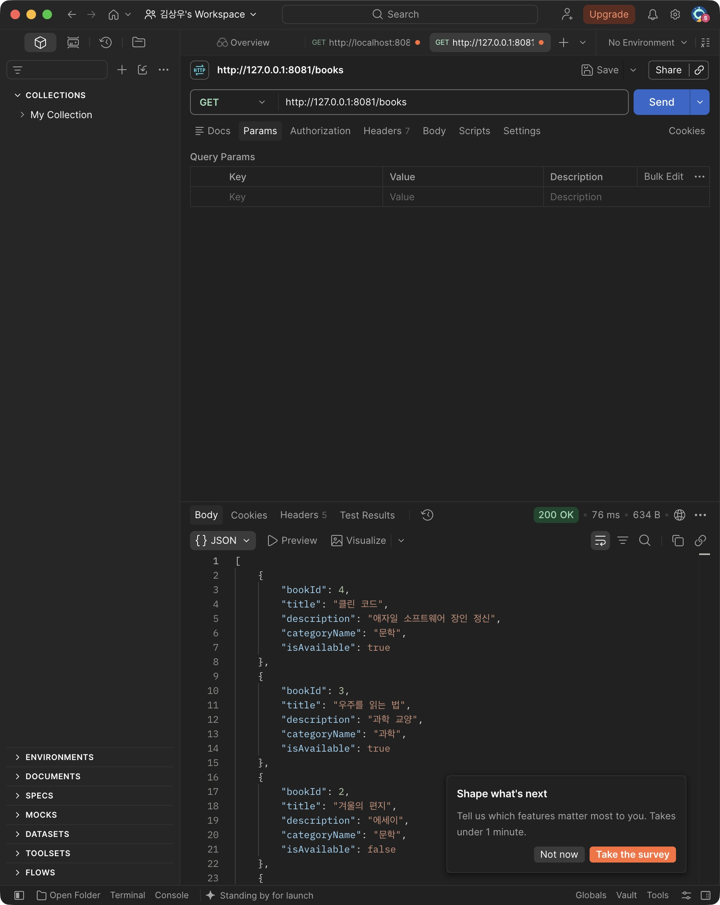

## 실습 2: 신규 도서 등록

요청 DTO를 `@Valid`로 먼저 검증한다. `CategoryRepository.findById()`로 카테고리 존재 여부를 확인한 후 `new Book(...)`을 저장하고 응답 DTO로 변환한다. 저장은 `@Transactional` 범위에서 수행한다.

실제 Postman 요청:

```json
{
  "categoryId": 1,
  "title": "4주차 ORM 실습 도서",
  "description": "JPA 등록 API와 DTO 응답 검증"
}
```

실제 응답: **201 Created**

```json
{
  "bookId": 5,
  "title": "4주차 ORM 실습 도서",
  "description": "JPA 등록 API와 DTO 응답 검증",
  "categoryName": "문학",
  "isAvailable": true
}
```

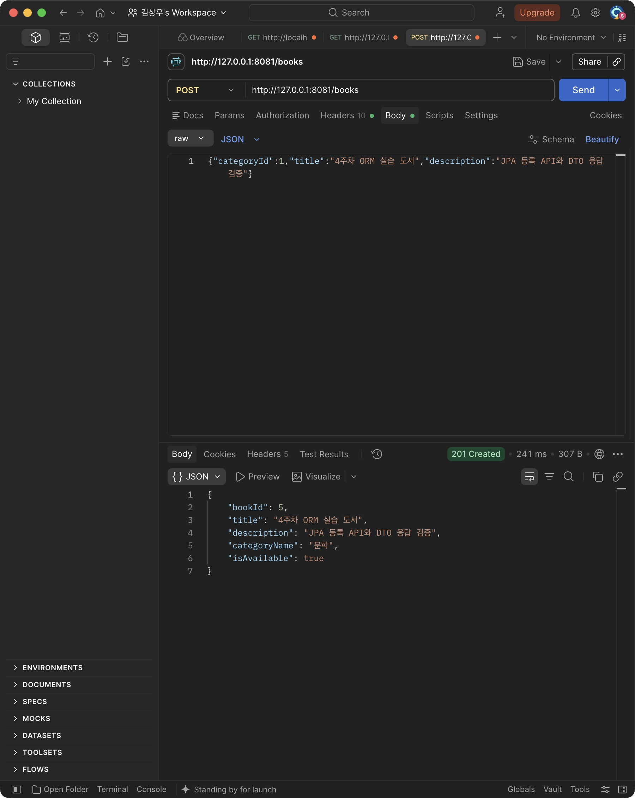

## 요청 검증과 예외 처리

| 요청 | 기대 결과 | 확인 결과 |
| --- | --- | --- |
| 도서 목록 조회 | 200, ID 내림차순, DTO 필드 | MySQL HTTP·Postman 확인 |
| 정상 등록 | 201, 생성 ID·카테고리명·대여 가능 값 | MySQL·Postman에서 ID 5 등록 |
| 공백 제목 | 400, `errors.title` | MySQL HTTP·Postman 확인 |
| 없는 카테고리 | 404, 원인이 드러나는 메시지 | MySQL HTTP·Postman 확인 |
| 제목 검색 | 200, 제목 포함 검색 | MySQL HTTP·Postman 확인 |
| 없는 검색어 | 200, 빈 배열 | MySQL HTTP 확인 |
| 제목 100자 | 201 | 자동 테스트 확인 |
| 제목 101자 | 400 | 자동 테스트 확인 |
| 카테고리 누락·0·음수 | 400 | 자동 테스트 확인 |
| 잘못된 JSON·문자/소수 카테고리 ID | 400 | 자동 테스트 확인 |

오류 응답도 `status`, `message`, `errors`로 일관되게 반환한다. 검증 실패와 없는 카테고리 요청 후에는 도서가 추가되지 않는 것을 확인했다.

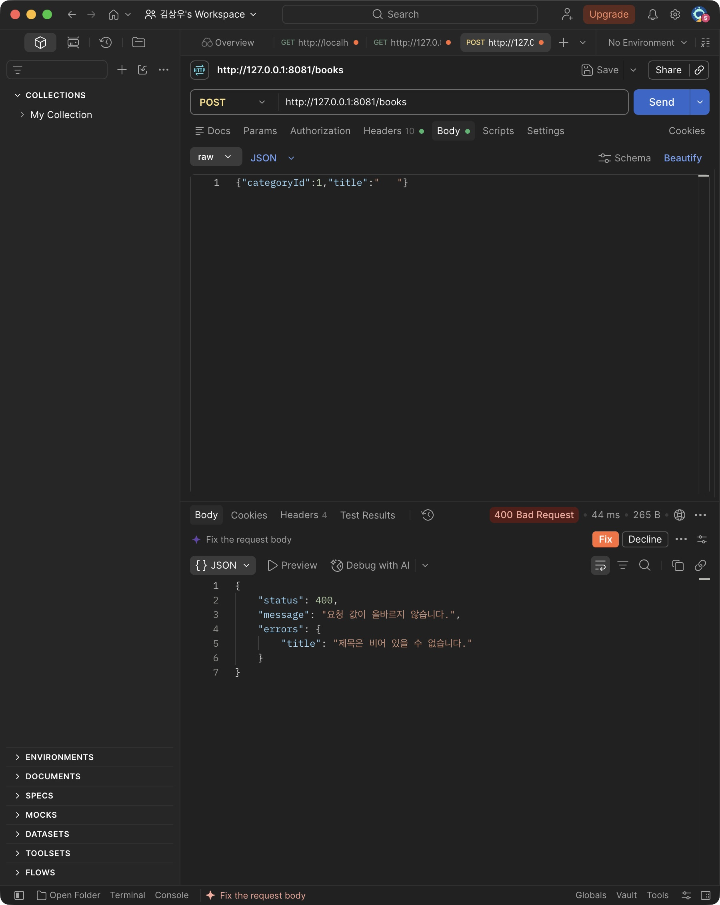

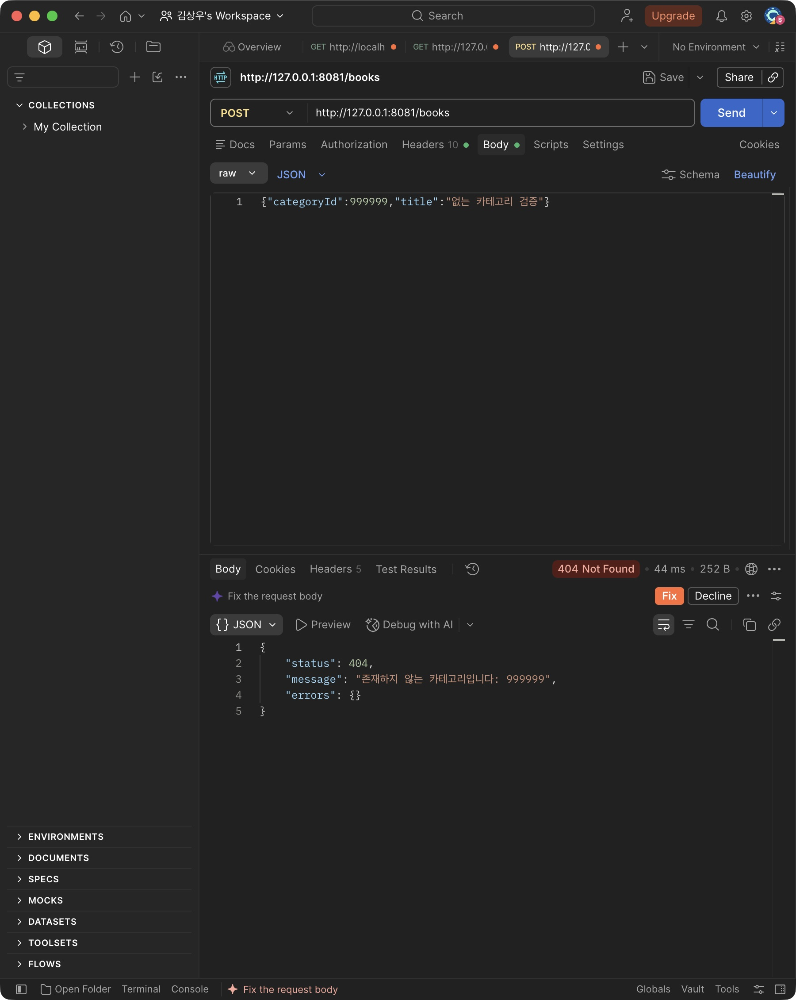

## 선택 미션: 도서 제목 검색

`findByTitleContainingIgnoreCaseOrderByBookIdDesc(keyword)`로 제목의 부분 일치 검색을 구현했다. 검색어 앞뒤 공백은 제거하고, 검색어가 없거나 공백뿐이면 전체 목록을 반환한다. 검색 결과가 없으면 오류 대신 빈 배열을 반환한다. 검색에서도 카테고리를 함께 조회하고 응답 DTO를 사용한다.

`GET /books?keyword=ORM` 요청은 등록한 `4주차 ORM 실습 도서` 1개를 반환했다.

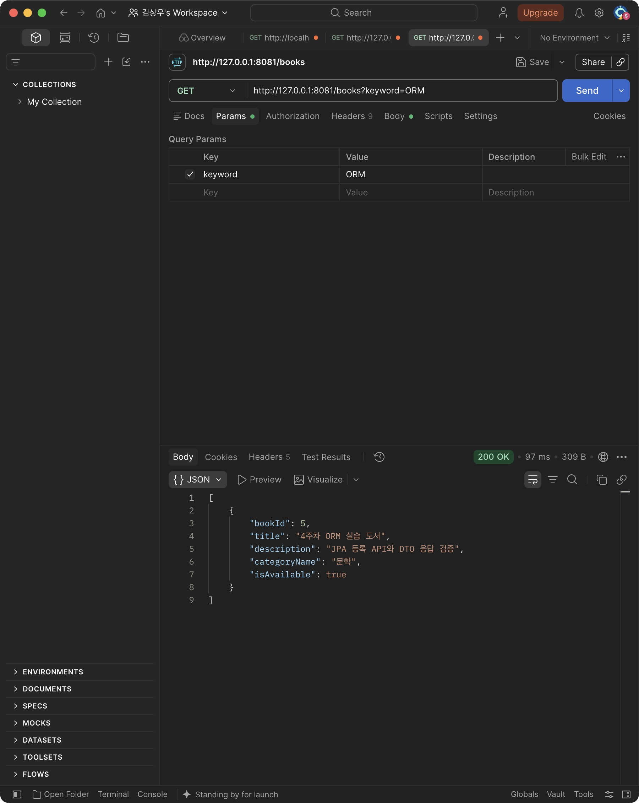

## 핵심 코드

이미지는 구현한 실제 소스 파일에서 생성했다. 파일명과 원본 줄 번호를 함께 표시했다.

| 역할 | 코드 파일 |
| --- | --- |
| Entity | `src/main/java/com/umc/study/entity/Book.java`, `Category.java` |
| DTO | `src/main/java/com/umc/study/dto/CreateBookRequest.java`, `BookResponse.java` |
| Repository | `src/main/java/com/umc/study/repository/BookRepository.java`, `CategoryRepository.java` |
| Service | `src/main/java/com/umc/study/service/BookService.java` |
| Controller | `src/main/java/com/umc/study/controller/BookController.java` |
| 예외 처리 | `src/main/java/com/umc/study/exception/ApiExceptionHandler.java` |

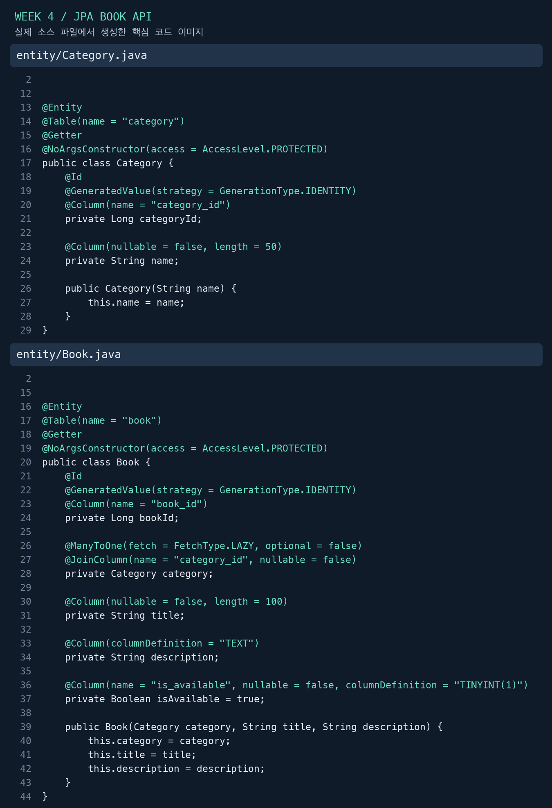

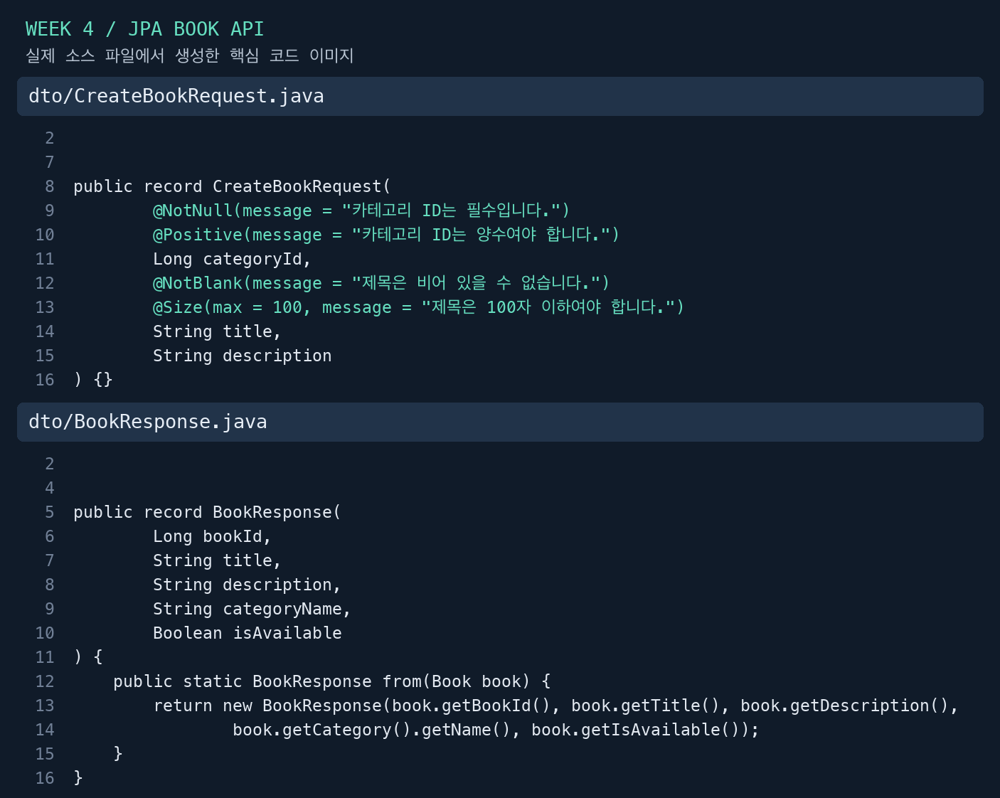

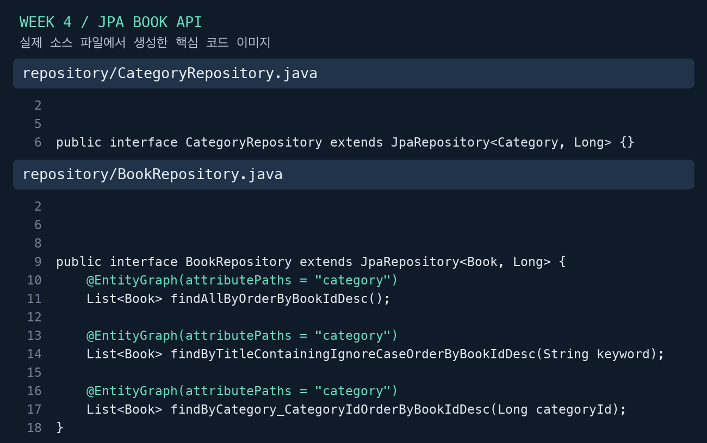

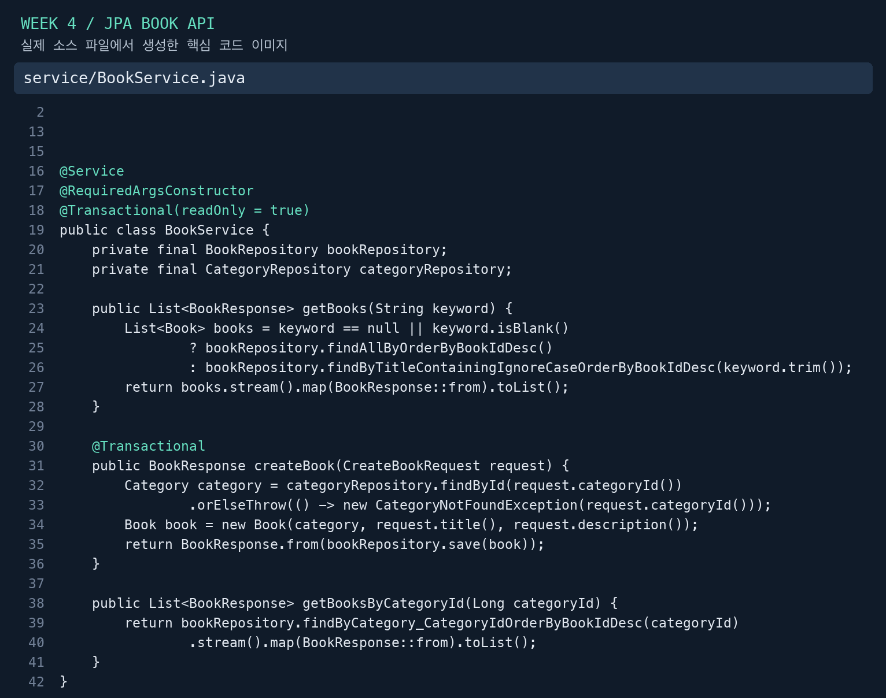

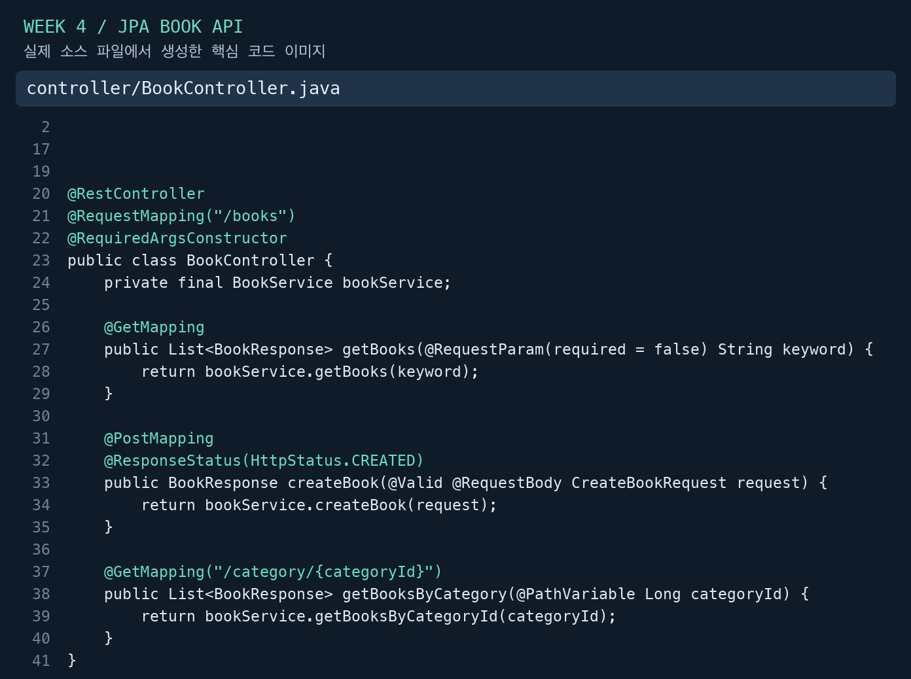

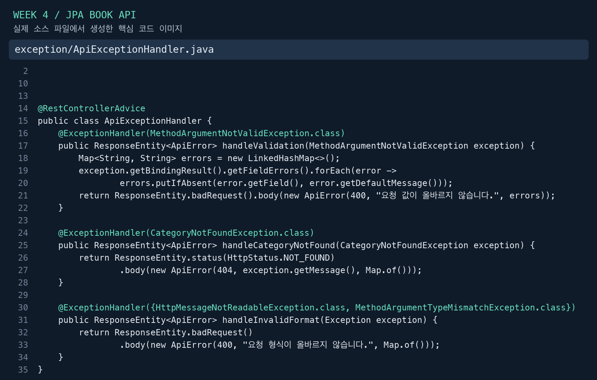

## Raw SQL 방식과 비교해 바뀐 점

3주차에는 `JdbcTemplate`에 SQL 문자열을 전달하고 `Map<String, Object>`로 조회 결과를 반환했다. 4주차에는 테이블과 관계를 엔티티로 선언하고 JPA Repository 메서드로 조회·저장을 표현했다. DB의 `snake_case` 컬럼명은 엔티티 내부 매핑에 두고, 클라이언트에는 응답 DTO의 `camelCase` 필드와 카테고리명을 제공한다. 요청 DTO의 Bean Validation과 카테고리 존재 확인을 추가해 잘못된 요청을 저장 전에 거절한다. 목록의 정렬·관계 조회와 등록의 트랜잭션 범위도 코드에 명시했다.

## 실행 결과 검증 한 문장

실제 MySQL에서 GET은 모든 도서를 최신순 응답 DTO로 반환하고 POST는 새 도서와 201을 반환했으며, 공백 제목은 400, 없는 카테고리는 404로 거절되어 필수 요구사항과 일치했다.

## 자동 테스트와 재현 방법

`./gradlew test bootJar` 결과: **16개 테스트 통과, 실패 0개**.

기본 자동 테스트는 `test` 프로필과 별도의 H2 메모리 DB를 사용하므로 로컬 MySQL 비밀번호가 필요 없다. H2에서는 테스트용 스키마를 생성·삭제하고 테스트 트랜잭션을 롤백한다. 실제 MySQL 연결과 기존 테이블 매핑은 별도로 `ddl-auto: validate` 서버에서 확인했다. H2 결과를 MySQL 검증으로 간주하지 않았다.

MySQL HTTP 결과는 `mysql-api-results.json`, 테스트 집계는 `test-summary.json`에 기록했다. Postman 응답 화면은 `screenshots/`에 있다.

Postman의 Import에서 `week4.postman_collection.json`을 선택한다. `baseUrl` 기본값은 검증 서버인 `http://127.0.0.1:8081`이며, IntelliJ에서 새 코드를 8080으로 실행할 때는 해당 값만 변경하면 된다. `categoryId=1`, `keyword=ORM`을 기본값으로 사용했다. 정상 POST 요청을 다시 실행하면 실습 도서가 추가로 등록된다.

## 핵심 키워드 정리

- **JPA / Hibernate / Spring Data JPA:** JPA는 객체와 테이블의 매핑·영속화를 다루는 표준이고, Hibernate는 이 프로젝트가 사용하는 구현체다. Spring Data JPA는 그 위에서 Repository 추상화와 기본 CRUD를 제공한다. 설정은 [Spring Boot SQL 데이터 문서](https://docs.spring.io/spring-boot/3.5/reference/data/sql.html)를 참고했다.
- **Entity Lifecycle / Persistence Context:** 엔티티는 신규, 관리, 분리, 삭제 상태를 거칠 수 있다. 영속성 컨텍스트는 관리 상태 엔티티를 추적하며, 변경이 SQL에 반영되는 시점은 flush·트랜잭션·ID 생성 전략의 영향을 받는다. 이 프로젝트의 IDENTITY 전략은 생성 ID를 얻기 위해 INSERT가 빨리 실행될 수 있어 `save()`가 항상 커밋까지 SQL을 미룬다고 이해하면 안 된다.
- **DTO / API Contract:** 엔티티는 DB의 구조와 관계를 표현하고 DTO는 요청·응답의 형식을 표현한다. 응답 DTO를 사용하면 엔티티의 내부 FK, 지연 로딩 프록시, 불필요한 관계가 응답에 노출되지 않는다.
- **Validation:** Controller의 `@Valid`와 요청 DTO의 제약으로 형식·필수값 오류를 Service 진입 전에 거절한다. 존재하는 카테고리인지 여부는 DB 조회가 필요하므로 Service에서 검사한다. [Spring Boot Validation 문서](https://docs.spring.io/spring-boot/3.5/reference/io/validation.html)를 참고했다.
- **N+1 Query:** 도서 목록을 한 번 조회한 뒤 각 도서의 카테고리를 따로 조회하면 쿼리가 반복될 수 있다. 이 구현은 `@EntityGraph`로 카테고리를 함께 조회하고 SELECT 한 번인지 자동 테스트로 확인한다. [Spring Data JPA 조회 문서](https://docs.spring.io/spring-data/jpa/reference/jpa/query-methods.html)를 참고했다.
- **Migration / 자동 스키마 변경:** 현재는 기존 MySQL 스키마를 변경하지 않고 엔티티와 맞는지 검증한다. 스키마를 변경할 때는 버전이 기록된 마이그레이션으로 변경·적용 순서를 관리한다. `validate`는 테이블을 만들어 주는 설정이 아니다.

## 학습 정리

ORM을 도입해도 PK/FK, 자료형, NULL 허용 여부와 실제 SQL을 이해해야 정확한 매핑을 만들 수 있다. DTO를 분리하면서 API에 필요한 정보만 전달하고, Controller의 입력 검증과 Service의 도메인 검증을 구분했다. 관계 데이터를 가져오는 방식은 응답뿐 아니라 실행 쿼리 수에도 영향을 주므로 정상 응답 확인과 함께 조회 횟수를 검증했다.

## 트러블 슈팅 및 예방

### Postman 본문 전송 확인

초기 오류 요청을 편집하는 과정에서 본문이 비어 전달되어 요청 형식 오류 400이 반환됐다. Postman에 `Content-Type: application/json`과 raw JSON 본문이 반영되도록 다시 입력한 후, 공백 제목이 `errors.title` 검증 오류 400으로 반환되는 것을 확인했다. 단순히 400이라는 상태만 확인하지 않고 응답 메시지와 요청 본문을 함께 확인해야 한다.

### 소수 ID가 정수로 변환되는 문제 예방

카테고리 ID는 양의 정수여야 한다. JSON의 소수 값이 Long으로 조용히 변환되지 않도록 `spring.jackson.deserialization.accept-float-as-int: false`를 적용하고 소수·문자 ID가 400인지 자동 테스트했다.

### 지연 로딩과 반복 조회 예방

`open-in-view: false`를 유지하고 Service의 읽기 트랜잭션 안에서 DTO를 만든다. 목록 Repository에는 EntityGraph를 적용해 카테고리를 한 번에 조회한다. 이 항목은 실제 장애를 겪었다는 기록이 아니라 예방 조치와 검증 내용이다.

## 실습 체크리스트

- [x] Spring Boot JPA·MySQL·Validation 설정
- [x] Book / Category와 다대일 관계
- [x] 요청 DTO의 제목·카테고리 ID 검증
- [x] GET /books ORM 조회 및 DTO 응답
- [x] POST /books 저장 및 201 응답
- [x] 빈 제목·없는 카테고리 오류 확인
- [x] 필수 핵심 코드 이미지
- [x] Postman GET·POST·오류 결과 이미지
- [x] Raw SQL 방식과 비교 3문장 이상
- [x] 실행 결과 검증 한 문장
- [x] 선택 미션: 제목 검색의 정상·결과 없음 검증

## 제출 자료

이 문서와 `screenshots/`, `code/`의 이미지를 미션 기록 페이지에 첨부하면 된다. 코드와 기록은 로컬 저장소에 준비했으며, GitHub 업로드와 Notion 페이지 게시·UMC 제출은 별도 단계다. 개인 학습 후기와 스터디 인증 사진은 본인의 실제 경험에 맞춰 덧붙인다.
